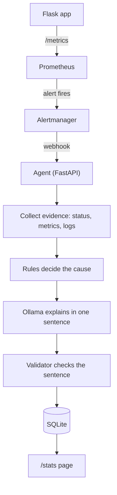

# IncidentSense

A  project that investigates an alert on its own and tells you the likely cause.

When a service goes down, someone has to check the metrics, the container state and the logs by hand. IncidentSense does this first check automatically and saves the result.

Everything runs on one laptop with Docker Compose. The language model runs locally through Ollama, so no logs leave the machine.

## What it does

1. A  Flask app runs in a container and exposes its numbers at `/metrics`.
2. Prometheus reads those numbers every 5 seconds.
3. An alert rule fires if the app is unreachable for 15 seconds.
4. Alertmanager sends the alert to the agent (a FastAPI service).
5. The agent collects evidence with three read-only checks: container status, a Prometheus query, and the last log lines.
6. A set of simple rules decides the cause from that evidence.
7. The language model (qwen2.5:7b through Ollama) explains the cause in one sentence. It can also ask for more evidence, up to 5 steps.
8. A validator checks the sentence. If the sentence is rejected, or the model fails, the agent uses a plain rule-based sentence instead.
9. The result is saved in SQLite and shown at `/stats`.



## Why it is built this way

- **The rules decide the cause, the model only explains it.** In an early test the model said "out of memory" for a container that was simply stopped with `docker stop`. Letting code decide the cause removed that mistake.
- **The validator** rejects an explanation that talks about memory when the rules say it was not memory, or that mentions things this setup does not have (for example Kubernetes).
- **The agent only reads.** It cannot restart, stop or change anything.
- **Secrets are removed from logs** (passwords, tokens, bearer headers, AWS keys) before the model or the database sees them.
- **The model runs locally** so logs stay on the machine.

## Causes the rules can report

`stopped_externally`, `memory_leak_oom`, `crash_loop`, `app_crash`, `scrape_failing`, `no_failure_detected`, `unknown`

## What I tested

| Test | What I did | Result |
|---|---|---|
| App stopped | `docker stop` on the app | Reported `stopped_externally` |
| Memory leak | Called `/chaos/leak` about 10 times with a 128 MB container limit | Container was killed for memory, reported `memory_leak_oom` |
| Healthy app | Sent a fake alert while the app was running | Reported `no_failure_detected` |
| Rules | Unit checks for 4 categories and 6 validator cases | All passed |
| Secret removal | Logged a fake password, then read it through the agent | Password was replaced with `[REDACTED]` |

## How to run

You need Docker Desktop and Ollama.

```
ollama pull qwen2.5:7b
docker compose up --build -d
```

Pages:
- App: http://localhost:5000/health
- Prometheus: http://localhost:9090
- Alertmanager: http://localhost:9093
- Past incidents: http://localhost:8000/stats

Try an incident:
- Stop the app: `docker stop incidentsense-app`
- Memory leak: open `http://localhost:5000/chaos/leak` about 10 times

Wait 2 to 4 minutes, then read the result:
```
docker logs incidentsense-agent --tail 5
```

Run the rule and redaction checks (Python 3.10):
```
python agent/rules.py
python agent/redact.py
```

## Limits

- Only the app-down alert exists. Memory leak and stopped app are the two failures I tested on a live container.
- `crash_loop`, `app_crash` and `scrape_failing` are in the rules but I have not triggered them on a live container yet.
- The model runs on CPU, so one investigation takes about 1 to 4 minutes.
- The validator is a keyword check. It catches the mistakes I saw, not every possible mistake.
- The agent container has access to the Docker socket to read logs and status. For anything beyond a laptop, this should go through a read-only proxy.
- It watches one app. I did not test multiple services.

## Files

- `app/` : the Flask app that gets broken on purpose
- `prometheus/` : scrape config and the alert rule
- `alertmanager/` : webhook config
- `agent/main.py` : webhook and `/stats`
- `agent/agent.py` : evidence collection and the model loop
- `agent/tools.py` : the three read-only checks
- `agent/rules.py` : cause rules and the validator
- `agent/redact.py` : secret removal
- `agent/db.py` : SQLite storage